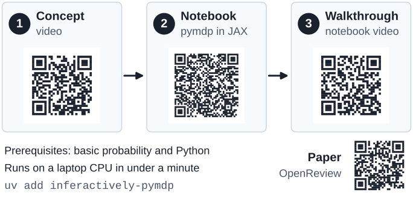
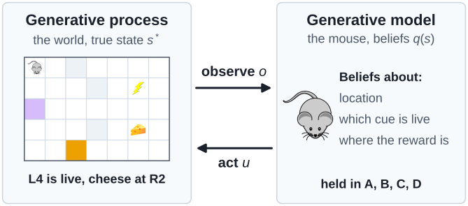

# Active Inference: A Brain-inspired Framework for Autonomous Decision Making

Teaching material for the **NeurIPS 2026 Education Track**: a concept video, a hands-on notebook in `pymdp` (JAX), a walkthrough video of the notebook, and the lecture slides.

**Ifrah Saeed, Aswin Paul, Adeel Razi**
Turner Institute for Brain and Mental Health, School of Psychological Sciences, Monash University, Australia

[Paper (OpenReview)](https://openreview.net/forum?id=9XnRP4dkSG) · [Concept video](https://youtu.be/2nSQ09TRUdY) · [Notebook](demo-generative-model.ipynb) · [Walkthrough video](https://youtu.be/2weXMtjK_-8) · [Slides](Active%20Inference%20Slide%20Deck.pdf)

<p align="center">
  
</p>

## Overview

How should an agent act when it does not yet know where its goal is? It has to reach the outcomes it prefers, and it also has to resolve the uncertainty between itself and those outcomes. Reinforcement learning typically values information only through the reward it eventually leads to, unless an exploration bonus is added. Active inference scores both demands with a single objective, the **expected free energy (EFE)**. Under EFE, resolving uncertainty has value in its own right, and information seeking follows from the agent's generative model.

This material introduces active inference to readers who have not met it before. It shows how an agent:

- **infers** the hidden causes of its observations by minimising variational free energy,
- **plans** by predicting the outcomes of candidate policies and scoring them by expected free energy, and
- **balances** preferred outcomes against information seeking, in a task where the reward cannot be found without first visiting two cues that pay nothing.

## Learning path

| Step | Material | What it covers |
|---|---|---|
| 1 | [Concept video](https://youtu.be/2nSQ09TRUdY) and [slides](Active%20Inference%20Slide%20Deck.pdf) | The agent–environment loop, generative models, variational free energy, POMDPs, policies and expected free energy |
| 2 | [Notebook](demo-generative-model.ipynb) | Building a generative model in `pymdp` (JAX) and running perception, planning and action on the cue chaining task |
| 3 | [Walkthrough video](https://youtu.be/2weXMtjK_-8) | A guided run through the notebook |

**Prerequisites:** basic probability (conditional distributions and Bayes' rule) and Python with NumPy.
**Hardware:** a laptop CPU is enough. The notebook runs in under a minute.

## The demo: cue chaining

<p align="center">
  
</p>

A mouse is placed in a 5×7 grid. The cheese is at one of two squares, R1 or R2, and the other square holds a shock. The only way to find out which is through two cues, visited in order. Standing on **CUE1** reveals which of four squares, L1 to L4, holds the live cue. Standing on the live cue then reveals whether the cheese is at R1 or R2. Neither cue gives any reward, so an agent that guesses is right half the time.

```
       c0     c1     c2     c3     c4     c5     c6
 r0  START    .      L1     .      .      .      .
 r1    .      .      .      L2     .      R1     .
 r2   CUE1    .      .      .      .      .      .
 r3    .      .      .      L3     .      R2     .
 r4    .      .      L4     .      .      .      .
```

The figure separates the **generative process** from the **generative model**. The generative process is the world and its true state $`s^*`$; in the episode shown, L4 is the live cue and the cheese is at R2. The generative model is the mouse's beliefs $`q(s)`$ about its location, which cue is live and where the reward is, held in the arrays **A** (likelihood), **B** (transitions), **C** (preferences) and **D** (initial-state prior). The mouse is told neither the live cue nor the reward location, and no rule in the code tells it to visit the cues. It visits them because the epistemic term of the expected free energy values the information they carry:

```math
-G(\pi) = \sum_{\tau} \Big( \underbrace{\mathbb{E}_{q(o_\tau \mid \pi)}\big[C(o_\tau)\big]}_{\text{pragmatic value}} + \underbrace{\mathbb{E}_{q(o_\tau \mid \pi)}\Big[D_{KL}\big[q(s_\tau \mid o_\tau, \pi) \,\|\, q(s_\tau \mid \pi)\big]\Big]}_{\text{epistemic value}} \Big)
```

### What the notebook shows

- The mouse's belief about the live cue collapses onto L4 when it stands on CUE1. Its belief about the reward collapses onto R2 when it stands on L4. Neither belief changes on any other square.
- The planning horizon must be at least as long as the longest gap in the chain, which is four steps here. With a horizon of one, the mouse never leaves the start. With a horizon of two or three, it reaches CUE1 and stops.
- Without the epistemic term, the mouse never leaves the starting square, because no reward lies within its horizon.
- The scale of the preferences **C** changes behaviour only where pragmatic and epistemic value compete. Shaping **C** to shorten the required horizon swaps the visit to a cue for exposure to the shock.
- When part of the likelihood is unknown, the mouse visits the cue only if parameter information gain ("novelty") is included in the expected free energy.

### Notebook outline

| Section | Topic |
|---|---|
| 1–2 | Setup and the cue chaining task |
| 3–4 | The generative model (**A**, **B**, **D**) and the agent's preferences, prior and planning horizon |
| 5–7 | One perception–planning–action loop at three levels of the `pymdp` API: individual calls, `infer_and_plan`, and a compiled `rollout` |
| 8 | What the agent believed at each timestep |
| 9 | Planning horizon, preference scale, removing the epistemic term, and preference shaping |
| 10 | Learning the likelihood with Dirichlet priors and parameter information gain |
| 11 | An animation comparing the true state with the agent's beliefs |
| 12 | Summary |

## Running the notebook

The notebook uses [`pymdp`](https://github.com/infer-actively/pymdp) and is set up with [`uv`](https://docs.astral.sh/uv/):

```bash
git clone https://github.com/aswinpaul/neurips26-teaching-material.git
uv init neurips-active-inference
cd neurips-active-inference
uv add inferactively-pymdp jupyterlab
cp ../neurips26-teaching-material/demo-generative-model.ipynb .
uv run jupyter lab
```

`uv` writes a `.venv/` and a lockfile that record the versions used. Do not pin `jax` by hand: `pymdp` already constrains it to `jax<0.11.1`, and an explicit pin tends to conflict with that. The CPU build of JAX is enough.

## Repository contents

| File | Description |
|---|---|
| [`demo-generative-model.ipynb`](demo-generative-model.ipynb) | Hands-on notebook: active inference with `pymdp` (JAX) on the cue chaining task |
| [`Active Inference Slide Deck.pdf`](Active%20Inference%20Slide%20Deck.pdf) | Lecture slides: from free energy to expected free energy, with a demo |
| [`Video Links.txt`](Video%20Links.txt) | Links to the concept video and the notebook walkthrough video |
| [`gen-model.svg`](gen-model.svg) | Figure: the generative process and the generative model |
| [`material-qr-codes.svg`](material-qr-codes.svg) | Figure: the learning path, with QR codes for each step and for the paper |
| [`LICENSE`](LICENSE) | MIT License |

## Further reading

- Parr, T., Pezzulo, G., & Friston, K. J. (2022). *Active Inference: The Free Energy Principle in Mind, Brain, and Behavior*. MIT Press.
- Namjoshi, S. V. (2026). *Fundamentals of Active Inference: Principles, Algorithms, and Applications of the Free Energy Principle for Engineers*. MIT Press.
- Sajid, N., Ball, P. J., Parr, T., & Friston, K. J. (2021). Active inference: demystified and compared. *Neural Computation*, 33(3), 674–712.

## Citation

If you use this material, please cite the accompanying paper on [OpenReview](https://openreview.net/forum?id=9XnRP4dkSG).

## License

Released under the [MIT License](LICENSE).
